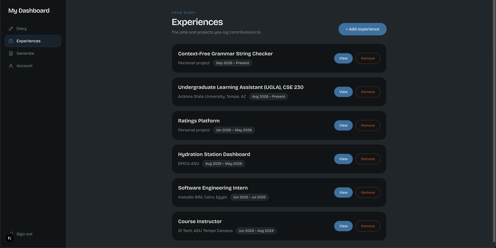
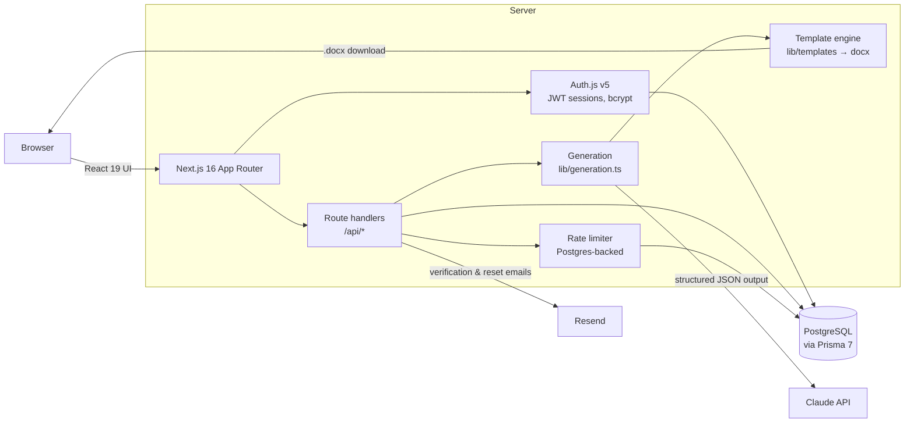

<div align="center">


### Make every experience count.

**Log your wins as they happen. Turn them into a tailored, one-page resume in under a minute.**

[**Try it live at rolediary.com →**](https://rolediary.com)


</div>

---

## The problem

You shipped a feature that cut load times in half. You led the migration nobody else wanted to touch. You onboarded three new hires.

Eighteen months later you're updating your resume, staring at a blank bullet point, and you can't remember any of it.

**Role Diary fixes that.** It's a work diary built for resumes. Jot down what you did while it's fresh, and when the right job comes along, Role Diary reads your diary and the job posting, then writes a resume that matches the role.

## How it works

<p align="center">
  <a href="https://rolediary.com">
    
  </a>
  <br />
  <sub>Every job and project you've done, in one place, ready to become your next resume.</sub>
</p>

```
  1. Add your roles            2. Log your wins              3. Generate
  ┌──────────────────┐        ┌──────────────────────┐      ┌───────────────────────┐
  │ Software Intern  │        │ Oct 14 · Cut CI time │      │ Paste a job posting   │
  │ Acme Corp        │  ───▶  │ from 12 to 4 min by  │ ───▶ │ → get a tailored,     │
  │ Jun 2025 – Now   │        │ caching Docker layers│      │   one-page .docx      │
  └──────────────────┘        └──────────────────────┘      └───────────────────────┘
```

1. **Log what you've already done.** Add your jobs and projects ("experiences"), each with a role, a place, and dates.
2. **Capture every win as it happens.** Add short diary entries to an experience whenever you achieve something, no matter how small. Each one is timestamped, so months or years later your diary is still there.
3. **Turn your diary into a resume.** Paste a job description and pick a template. Claude chooses the most relevant experiences, writes achievement-focused bullets, sorts your skills into categories, and returns a polished, ATS-friendly **Word document** sized to fit on one page.

### Highlights

- **Tailored to each job.** Every resume is written against a specific job description. It uses the posting's own keywords where your diary supports them, puts the most relevant work first, and leaves out the rest.
- **Your facts only.** The model is told never to invent employers, metrics, dates, or skills. Everything on the page comes from your diary.
- **Fits on one page.** Each template has a bullet budget. The prompt asks Claude to stay within it, and the server trims anything over the limit before the document is rendered.
- **Bring your own template.** Want a different layout? Export your whole diary as a ready-to-paste prompt (copy or download) and use it with any AI chat and any resume template.
- **Your data stays yours.** Download everything you've entered as JSON, or delete your account and all of its data from your account settings.

## Architecture

Role Diary is a single Next.js 16 app (App Router). Server components and route handlers talk to PostgreSQL through Prisma, and resume generation calls the Claude API with a strict JSON schema.



### What happens when you click "Generate"

1. **`POST /api/generate`** checks your session, validates the input (with size caps), and makes sure your email is verified.
2. A **daily generation quota** is counted *before* calling Claude, so parallel requests can't get past it. If generation fails, the request is refunded.
3. Your experiences and diary entries are flattened into plain text and sent to **Claude** along with the job description, the template's skill categories, and its length budget.
4. Claude replies with **structured output** that must match a JSON schema built for that template (skills, experience, projects). Skill categories are an `enum`, so the model can only use categories the template knows how to render.
5. `fitToBudget` trims any bullets over the template's limit, starting from the least relevant ones.
6. The template's `render()` merges in your name, contact details, and education, then builds a `.docx` with the [`docx`](https://github.com/dolanmiu/docx) library. The file streams straight back to your browser.

### Data model

```
User ──┬── Experience ── Contribution (diary entry)
       ├── Education
       ├── VerificationToken   (hashed)
       └── PasswordResetToken  (hashed)

RateLimit   (fixed-window counters keyed by IP / user)
```

Deleting a user cascades to everything they own.

### Security & reliability

- **Email/password auth** with bcrypt hashing, email verification, and password reset via one-time links.
- **Only token hashes are stored**, so a leaked database can't be used to verify emails or reset passwords.
- **Rate limits stored in Postgres**, so they hold across serverless instances. They cover sign-in attempts (per account+IP and per IP), sign-ups, reset emails, and daily generations. The counters use an atomic `INSERT … ON CONFLICT` upsert.
- **Email links are built from `AUTH_URL`** in production, never from the request's `Host` header, so a forged host can't point reset links at someone else's site.
- **Input caps** on job descriptions and coursework keep any single request from running up a large API bill.

### Project layout

```
app/
  api/            Route handlers: auth, account, experiences, contributions, generate
  dashboard/      Signed-in app: diary, experiences, generate, account
  components/     UI, onboarding flow, account settings
lib/
  generation.ts   Claude prompt + JSON schema
  templates/      Resume templates (docx renderers + page budgets)
  rateLimit.ts    Postgres-backed rate limiting
  aiPrompt.ts     "Bring your own AI" export prompt
  diaryExport.ts  Full data export
prisma/           Schema and migrations
auth.ts           Auth.js configuration
```

## Tech stack

| Layer      | Choice                                            |
| ---------- | ------------------------------------------------- |
| Framework  | Next.js 16 (App Router), React 19, TypeScript     |
| Styling    | Tailwind CSS 4                                    |
| Auth       | Auth.js (NextAuth v5), bcryptjs                   |
| Database   | PostgreSQL, Prisma 7 with the `pg` driver adapter |
| AI         | Anthropic Claude API with structured outputs      |
| Documents  | `docx`                                            |
| Email      | Resend                                            |

## Running locally

**Prerequisites:** Node.js 20+, a PostgreSQL database, and an [Anthropic API key](https://console.anthropic.com/).

```bash
git clone https://github.com/mido4499/rolediary.git
cd resumeresolve
npm install                 # also generates the Prisma client

cp .env.example .env        # then fill in the values below
npm run db:migrate          # apply migrations to your database
npm run dev                 # http://localhost:3000
```

| Variable            | Purpose                                                              |
| ------------------- | -------------------------------------------------------------------- |
| `DATABASE_URL`      | Postgres connection string                                           |
| `AUTH_SECRET`       | Signs session cookies. Generate one with `npx auth secret`           |
| `AUTH_URL`          | Public site address (required in production), e.g. `https://rolediary.com` |
| `ANTHROPIC_API_KEY` | Used for resume generation                                           |
| `RESEND_API_KEY`    | Sends verification and reset emails. Optional locally: without it, the links are printed to the console |
| `EMAIL_FROM`        | Sender address on a domain verified in Resend                        |

### Adding a resume template

Templates live in [`lib/templates/`](lib/templates/). A template is an object with:

- `skillCategories`: the skill groups it renders, in order (`"Others"` is added automatically)
- `budget`: how many bullets, and how many characters per bullet, fit on one page
- `render(data)`: returns a `docx` `Document`

Register it in [`lib/templates/index.ts`](lib/templates/index.ts) and it appears in the generate form.

## Contributing

Issues and pull requests are welcome. If you're planning a larger change, open an issue first so we can talk it through.

## License

[MIT](LICENSE) © Ahmed Shaheen

<div align="center">

**Stop forgetting your best work. [Start your diary →](https://rolediary.com)**

</div>
